title=Getting started with Elastic Cloud Managed OTLP Endpoint (mOTLP) and Spring Boot 4.x
date=2026-10-01
type=post
tags=java,spring,elastic,otlp
status=published
~~~~~~

In this tutorial, we'll explore a simple and clear way to **integrate observability into your workloads using Spring Boot 4.x and Elastic Cloud** through mOTLP.

By the end of this tutorial, you'll have a configuration similar to:

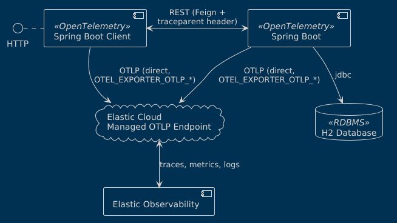

## Revisiting OpenTelemetry

One of the simplest ways I've found to describe OTLP is to **think of observability as a data pipeline**, similar to the one in the following image:

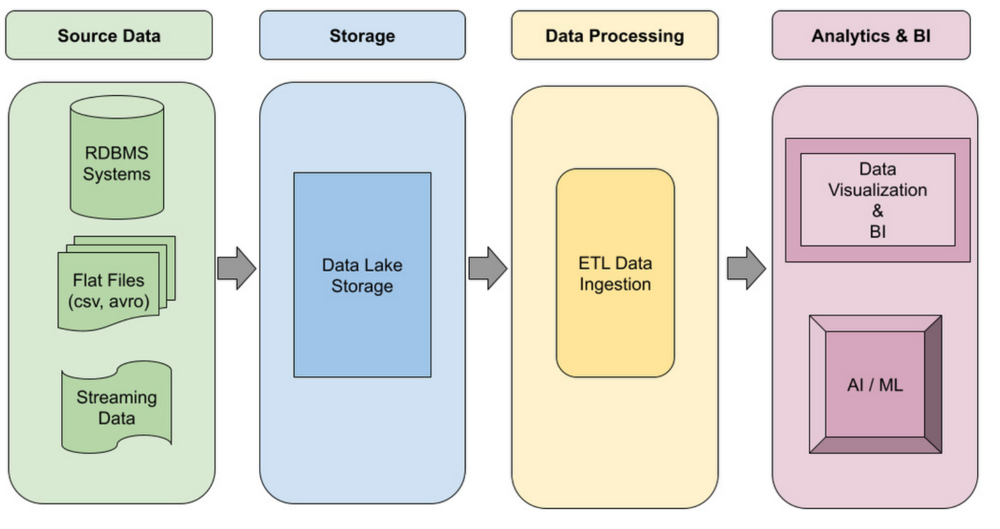

In most data pipelines, regardless of the technology, **we establish the following stages**:

1. We identify one or more data sources
2. We centralize and pre-process the data to send it to an analysis platform
3. From which we draw conclusions and take actions based on data

In the DevSecOps world, this analysis platform has become mandatory to operate our heterogeneous workloads. Whether it's root cause analysis, incident resolution, alerting, or even autonomous agents, **the data generated by our applications is fundamental to decision-making**.

As a result, the logical consequence was the creation of a protocol so that all components of the ecosystem can participate in these efforts. This effort is [OpenTelemetry, a top-level project of the Cloud Native Computing Foundation](https://www.cncf.io/projects/opentelemetry/).

OpenTelemetry's proposal is as follows:


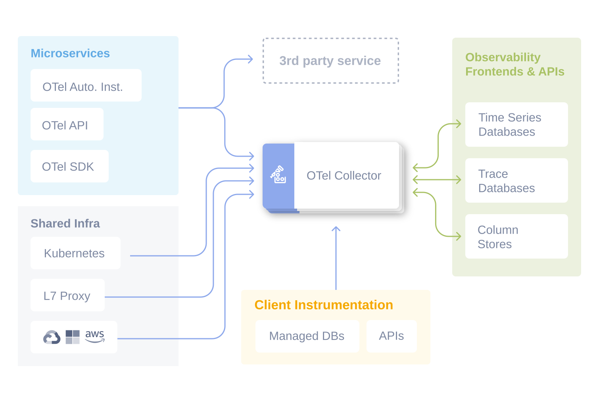

Through abstractions and similar to a data pipeline, OpenTelemetry allows us to:

1. Instrument our workloads and/or access instrumentation from third-party services
2. Deliver this data to lightweight intermediaries (collectors) that can be chained together
3. Send information to storage and analysis platforms

**All of this through a common protocol with support for HTTP or protobuf formats**.

## What is mOTLP and why is it a good idea?

As I demonstrated [in a previous post](https://vorozco.com/blog/2024/2024-11-18-A-practical-guide-spring-boot-open-telemetry.html), **configuring these collectors and observability platforms is an extensive task**. So cloud providers—like Elastic—offer, in addition to the analysis platform, [receivers/collectors compatible with the OpenTelemetry protocol](https://www.elastic.co/docs/reference/opentelemetry/managed-inputs/managed-otlp-endpoint). 

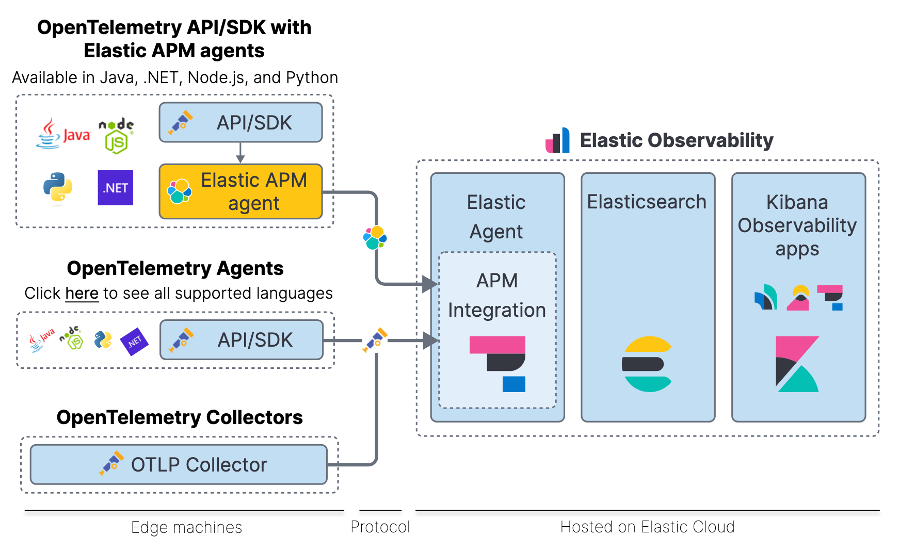

In this configuration, **your workloads deliver the three dimensions of observability (traces, metrics, logs) directly to an OTLP-compatible endpoint** with the following advantages:

1. Simple configuration based on a URL and a credential
2. [NoOps implementation](https://www.forrester.com/report/augment-devops-with-noops/RES59203) of information transfer to the analysis platform
3. Vendor independence thanks to OTLP being a neutral protocol

And, of course, with some special considerations:

1. Without an intermediate collector, we can't apply data filtering beforehand
2. We need to plan data delivery in case of disasters
3. It's not a configuration suitable for on-premise deployments

## Configuring a project in Elastic Cloud

The simplest way to explore this functionality is directly in Elastic, **specifically in a [Serverless project](https://www.elastic.co/docs/deploy-manage/deploy/elastic-cloud/serverless), where services are managed by Elastic**. When you create this project, there's a specific template for observability -Elastic for Observability- that will work in most situations.

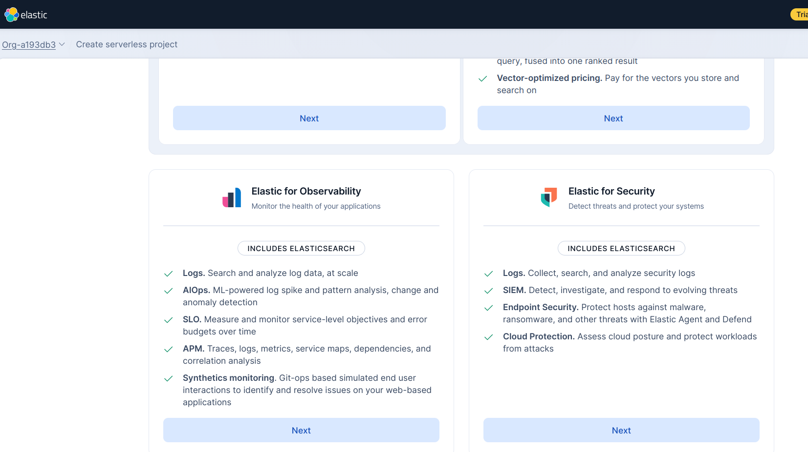

By default, a serverless project will let you choose from three cloud providers: Azure, Google, and Amazon.

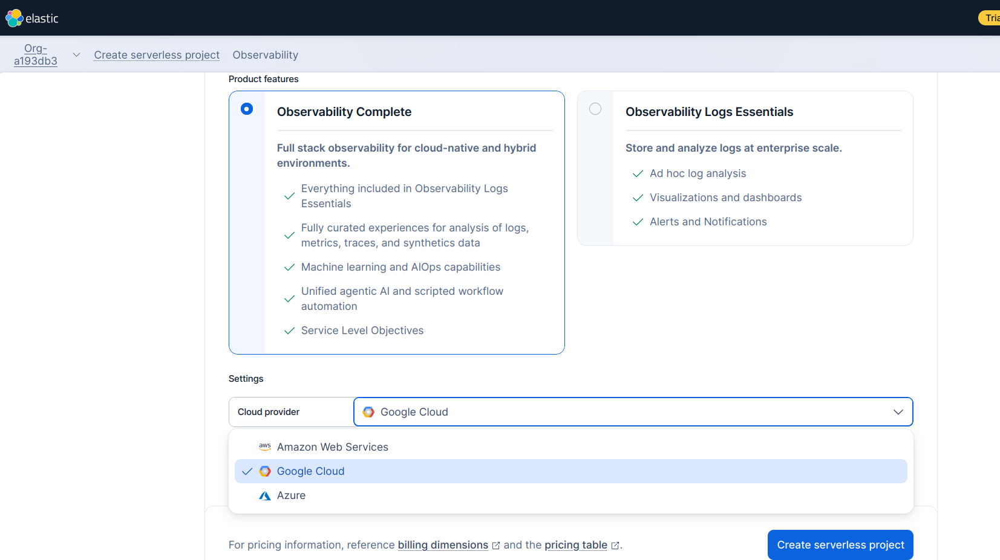


When you're done, you'll have a Kibana-based workspace similar to the following:

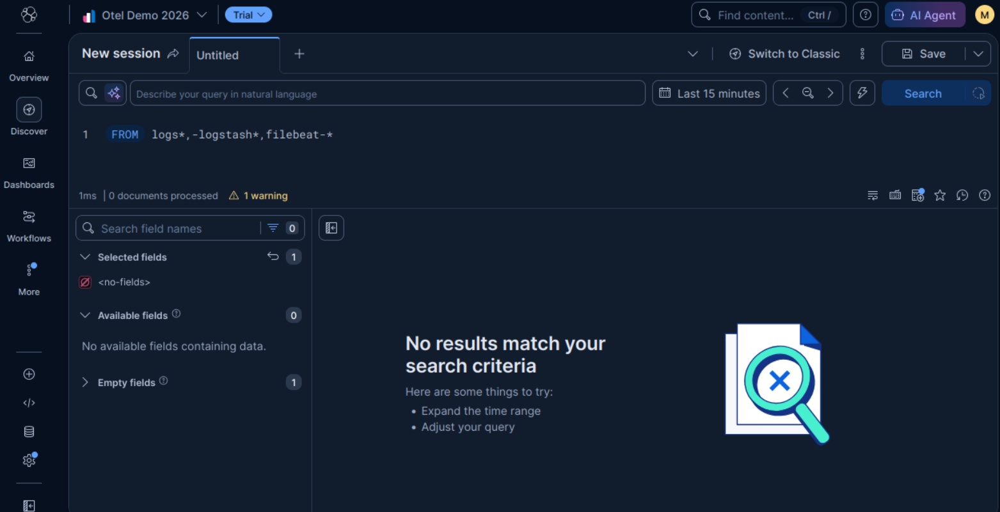


## Instrumentation Variables

**The Kibana dashboard offers a fairly explicit section for adding data**, among which you'll see the OpenTelemetry option.

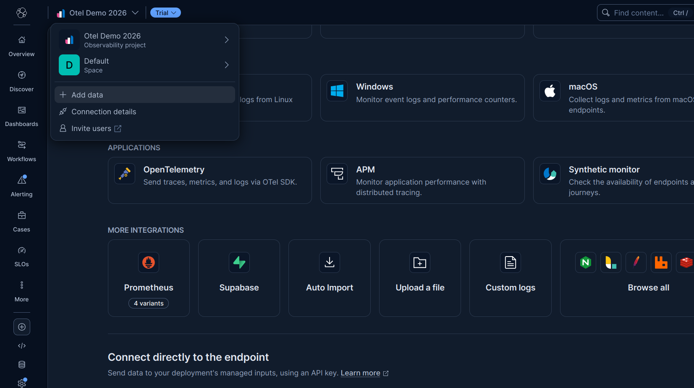


Among other things, the assistant provides useful links to instrument workloads in various programming languages. The assistant will also ask you for a service name and provide 3 important elements:

* A transmission endpoint
* A token in the form of a header
* Attributes based on your service name

You should **store these securely** as they'll be useful for integrating our instrumentation.

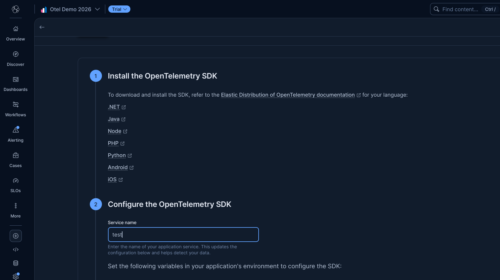


## Integrating Instrumentation into Spring Boot

For this demonstration, I've prepared two services that can be run locally:

* [**Springboot demo**](https://github.com/tuxtor/elastic-spring-boot-otel-poc/tree/main/springboot-demo): A CRUD on H2, and some additional examples
* [**Springboot client demo**](https://github.com/tuxtor/elastic-spring-boot-otel-poc/tree/main/springboot-client-demo): A REST client based on OpenFeign configured to consume Spring Demo (and consequently create traces)

[Full source code is available at GitHub](https://github.com/tuxtor/elastic-spring-boot-otel-poc).

For Java, there are two main ways to instrument workloads:

1. [Deploy an Agent on any JVM](https://opentelemetry.io/docs/zero-code/java/agent/)
2. Implement instrumentation with framework-specific libraries.


In the case of Spring Boot, there are TWO major instrumentation options:

1. [OpenTelemetry's Spring Boot starter](https://opentelemetry.io/docs/zero-code/java/spring-boot-starter/)
2. [Micrometer](https://spring.io/blog/2025/11/18/opentelemetry-with-spring-boot)

For this post, we'll use option #1 in both artifacts, which I consider the simplest.

## Instrumenting springboot-demo and springboot-client-demo with OpenTelemetry Spring Boot starter

As always, [it is also good to consider the official documentation](https://opentelemetry.io/docs/zero-code/java/spring-boot-starter/getting-started/).

Otel instrumentation with the Spring starter is activated in three steps:

* You need to include both the OpenTelemetry BOM and OpenTelemetry dependency in project's classpath. If you're planning to also use Micrometer metrics, it's also a good idea to include Spring Actuator. For example in a classic maven Java project:

```prettyprint
<dependencyManagement>
    <dependencies>
        <dependency>
            <groupId>io.opentelemetry.instrumentation</groupId>
            <artifactId>opentelemetry-instrumentation-bom</artifactId>
            <version>2.33.1</version>
            <type>pom</type>
            <scope>import</scope>
        </dependency>
    </dependencies>
</dependencyManagement>
...
<dependency>
    <groupId>io.opentelemetry.instrumentation</groupId>
    <artifactId>opentelemetry-spring-boot-starter</artifactId>
</dependency>
```

* There is a set of [optional libraries and adapters](https://github.com/open-telemetry/opentelemetry-java-instrumentation/blob/main/docs/supported-libraries.md#libraries--frameworks) that you can configure if your workloads have already diverged from the "Spring Way".

* Finally, you need to activate (or not) the observability dimensions (metrics, traces, and logs). Also, [you can fine-tune the exporting parameters](https://opentelemetry.io/docs/zero-code/java/spring-boot-starter/out-of-the-box-instrumentation/) like ports, URLs, or exporting periods. You can do this using Spring Properties or environment variables:

```prettyprint
# Configure exporters
otel.logs.exporter=otlp
otel.metrics.exporter=otlp
otel.traces.exporter=otlp

# Configure metrics generation
otel.metric.export.interval=5000 # Export metrics every five seconds
otel.instrumentation.micrometer.enabled=true # Enable Micrometer metrics bridge
```

## Simulating Load

If you already explored the source code, **you probably noticed there are not credentials in the properties file**. As suggested in the configuration within Elastic Cloud, the most recommended approach would be to inject these values through environment variables. For example, the following .env file would be sufficient for local development:

```prettyprint
export OTEL_EXPORTER_OTLP_ENDPOINT="https://my-observability-project-..."
export OTEL_EXPORTER_OTLP_HEADERS="Authorization=ApiKey dX..."
```

Which you can source as part of the execution of these services (on local testing environment).

```prettyprint
source .env
```

Then, it's time to boot the services. You only need Java 25 on the active shell:

```prettyprint
cd springboot-demo
mvn spring-boot:run
```

And:

```prettyprint
cd springboot-client-demo
mvn spring-boot:run
```

To demonstrate observability in the three dimensions, both sprinboot-demo (8080) and springboot-client-demo (8081) have some interactions to:

Generate CPU workload using Naive Fibonacci:

```prettyprint
curl http://localhost:8080/fibo\?n\=45
```

Generate logs at different levels:

```prettyprint
curl http://localhost:8080/log
```

Persist data using a CRUD:

```prettyprint
curl -X POST --location "http://localhost:8080/books" \
-H "Content-Type: application/json" \
-d '{
"author": "Miguel Angel Asturias",
"title": "El señor presidente",
"isbn": "978-84-376-0494-7",
"publisher": "Editorial planeta"
}'
```

And then retrieve the data using a secondary service:

```prettyprint
curl http://localhost:8081/trace-demo 
```

## Observing Results in Elastic Cloud

After running the above commands and allowing a few seconds for data propagation, you should see observability data flowing into your Elastic deployment. **The best way to confirm this is by using the Discovery tab, where you can explore data using ES|QL queries**. Also, the Cloud instance offers an AI assisted query builder, capable of translating natural language queries to actual deterministic queries.

### Logs

You'll see structured logs from both services showing:

- Request/response cycles
- Application lifecycle events
- Errors and exceptions (if any)

The logs are automatically enriched with:

- Service name
- Trace ID (correlating with traces)
- Span ID (for distributed tracing context)
- Timestamp
- Log level (INFO, WARN, ERROR)

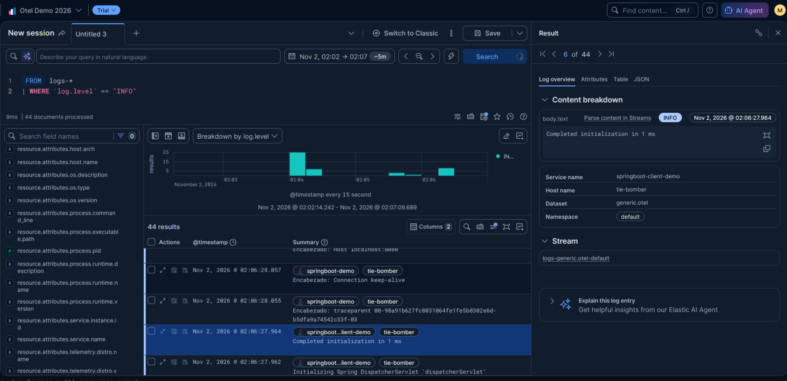


For example, when you hit the logs endpoint, you'll see entries like:

```
INFO  Info level
```

### Metrics

You'll observe application and JVM metrics being reported every 5 seconds (based on our configuration):

**Application Metrics:**

- HTTP request counts and durations
- Request error rates
- Active connections

**JVM Metrics:**

- Heap memory usage
- CPU time consumption (especially visible after fibonacci calls)
- Garbage collection events
- Thread counts

Run the fibonacci operation multiple times and watch the CPU metric spike:

```prettyprint
for i in {1..5}; do curl http://localhost:8080/fibo\?n\=45; done
```

You'll see corresponding CPU utilization spikes in Elastic, with each spike correlated to your curl requests.

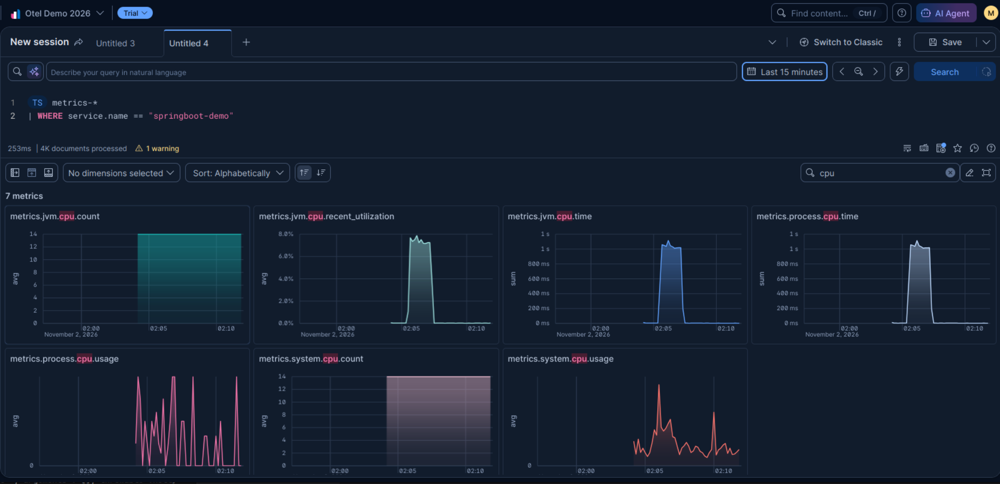


### Traces

The **Traces** reveal the full journey of each operation through your system:

**Example trace from `/trace-demo`:**

1. **springboot-client-demo** initiates an HTTP GET request
2. Trace follows to **springboot-demo** CRUD operation
3. Database query to H2
4. Response back through the call chain

Each span shows:

- Operation name
- Service name
- Start time and duration
- Attributes (HTTP method, status code, database operation, etc.)
- Parent-child relationships

Click on any span to see:

- Exact timing
- Custom attributes you've added
- Status (success/error)
- Resource information (service version, environment)

**Correlation across dimensions:** The trace ID connects all three observability dimensions. A single trace ID appears in logs, metrics, and traces, allowing you to correlate a user request with log entries and performance metrics—the foundation of effective observability.

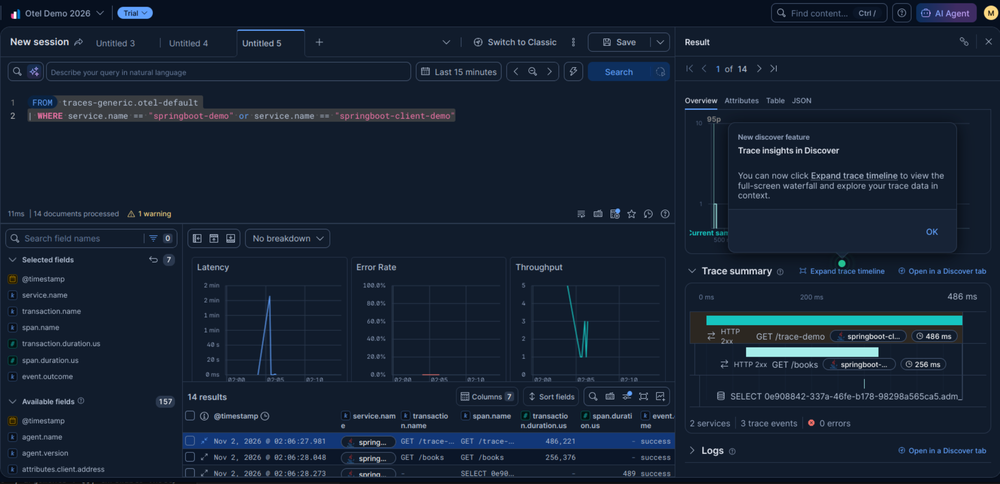


### Service inventory view

Kibana also includes an "eagle-eye" in the service inventory section. Where you can spot-check all the tree dimensions, in a service-oriented way.

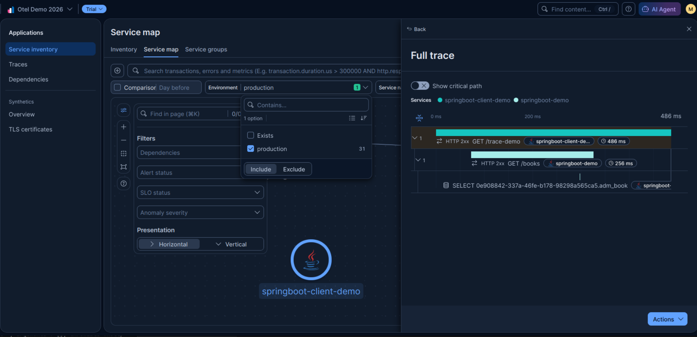


## Final Comment

mOTLP is one of many options to implement observability in our Java workloads. In my opinion, **it's one of the easiest ways to get fast results and enable the next level**: doing something with the data, like dashboards, alarms, and even AI analysis. So don't miss my next publications on these topics.
